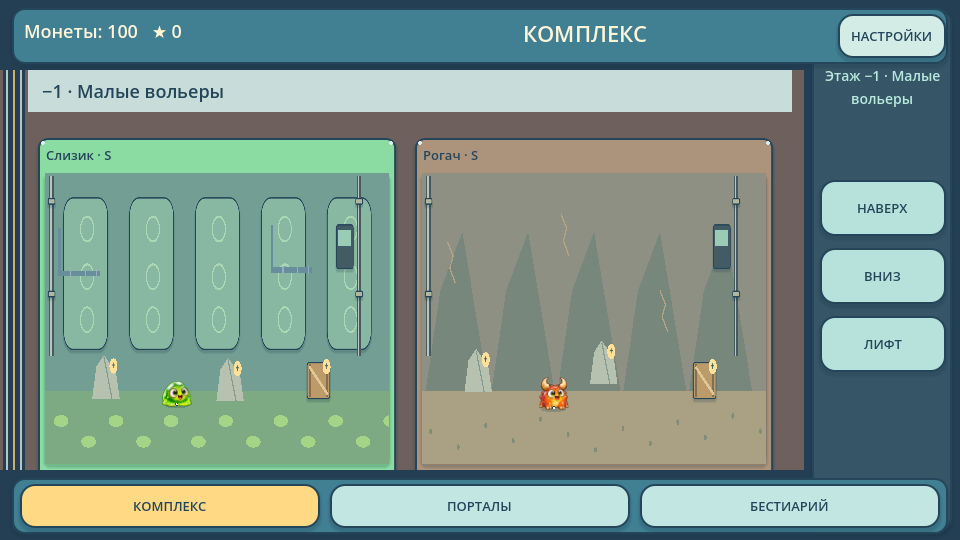
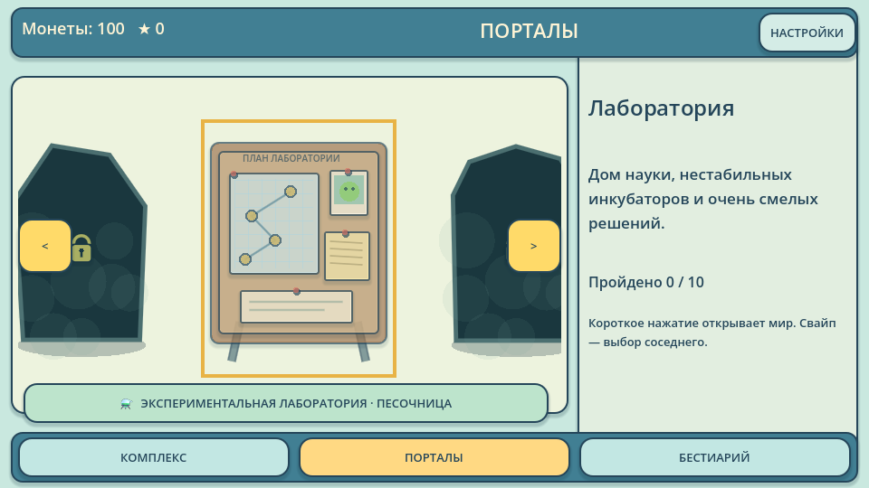
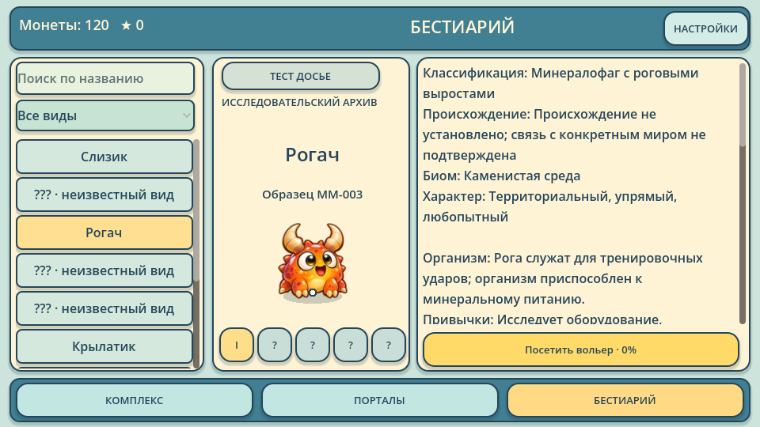
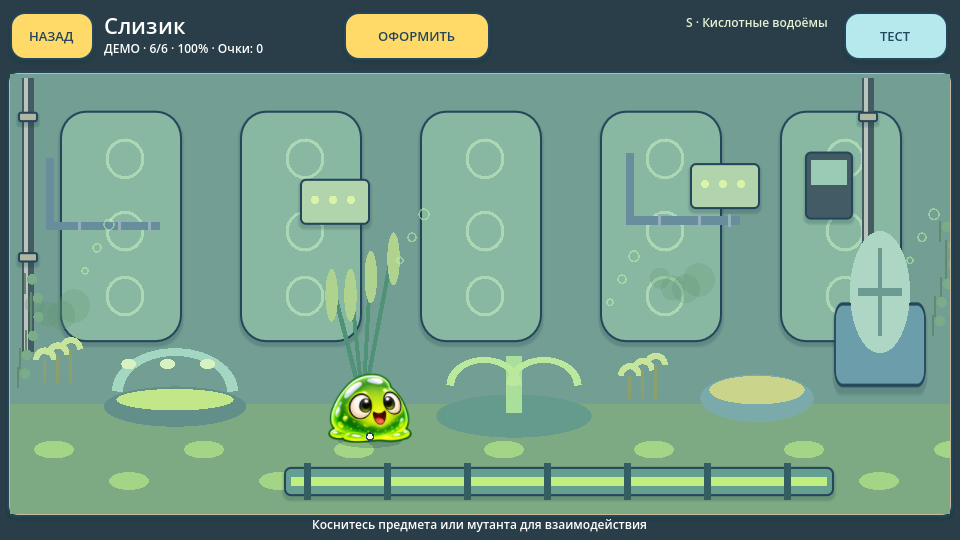
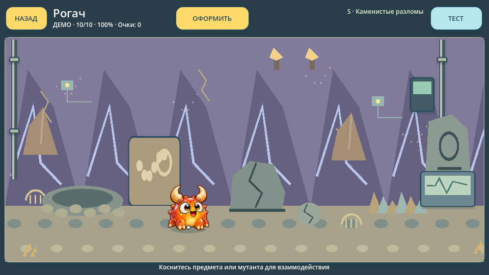

# PR20 — Bestiary & Living World Progression

Основа: main 1c5fea2 (объединённый PR19), ветка feature/bestiary-world-progression.
Godot 4.7.2, Android landscape, логический экран 960×540. PR не объединяется автоматически.

## Главный экран и маршруты

Обычный запуск открывает исследовательский комплекс. Вступление не удалено: профиль
без просмотренного intro и завершённых уровней получает прежнюю сцену поверх комплекса.
После завершения/пропуска остаётся комплекс; просмотренное вступление не повторяется.

Общая навигация содержит Комплекс, Порталы и Бестиарий; ресурсы и настройки сохранены.
Песочница доступна в портал-холле через обозначенную экспериментальную зону под стендом.
Она использует прежние поле, создание, слияния, экономику, сохранение и тактический эксперимент.
Вход в кампанию по-прежнему проходит через карту/предпросмотр, отдельные состояния не смешиваются.
Настройки возвращают к исходному разделу; Back в корне комплекса не открывает песочницу.
Головоломки и вольеры сохраняют минимальный специализированный UI.

## Планировка и сохранения

Фактический порядок первого появления в campaign/levels: slime — уровень 1, eyeball — 6,
horn — 10. В обзоре первого подземного этажа Слизик расположен слева перед Рогачом.
Оба используют S, width=940. Крылатик остаётся закрытым кандидатом M на следующем этаже;
гигантская камера и глубинные комнаты сохранены.

Стабильные species_id, habitat_id, slot_id, design_id и профиль v2 не менялись.
Расположение — представление, а не адрес сохранения; переходы находят этаж по habitat_id.
Для Слизика заново расставлены шесть предметов: ложе слева, растительность за дорожкой,
резервуар в центре, питание справа, лаборатория у края, каналы в переднем нижнем слое.
Размеры предметов и области касания заданы отдельно, а не уменьшены вместе с широким миром.
Миграция для уменьшения комнаты не нужна: те же варианты и очки загружаются без изменения файла.

Средняя конфигурация PR19 вынесена в tests/fixtures/ecosystem_slime_medium.json и
ecosystems_pr19.json. M/L проверяются отдельно; XL сохраняет прежнюю регрессию PR19.
Флаги старой презентации нужны только прежним тестам. --living-world-legacy сохраняет
PR19-интерфейс и M-fixture; обычный запуск использует новую S-комнату и бестиарий.

## Автоматическое преображение

data/environment_progression.json задаёт пороги, слои, типы, цвета, позиции и необязательную
texture для каждого habitat_id. environment_progression.gd — общий валидатор/рендерер.
Распознаются дальний фон, стены, вторичные конструкции, грунт, мелкие детали, предметы,
передний план, свет и атмосфера; мутант остаётся собственным слоем между предметами и передним планом.

Пороги: 0/20/40/60/80/100 процентов. Система каждый раз выводит активные слои из числа
установленных слотов относительно полного каталога, применяя все подходящие пороги.
Отдельный показатель не сохраняется; декорации не имеют стоимости и не создают слотов.
Предпросмотр и бесплатная смена оформления не увеличивают развитие.

Рогач получает трещины, датчики/кабели, вторичные скалы, окаменелости, мелкие осколки
и атмосферную пыль со световыми точками датчиков. У Слизика — трубы, панели, биоплёнки,
грибы, краевые лианы и пузырьки. Это разные формы и композиции, не простая смена палитры.
Декорации не создают Control, hitbox или коллизии. Крупные функциональные объекты не дублируются.
Необязательная PNG-текстура заменяет процедурный мотив без изменения прогресса.
Атмосфера обновляется только у активной среды; скрытые комнаты не получают новый таймер/процесс.

В каталоге Слизика шесть слотов: одна установка даёт около 16,7%. Поэтому реальные
контрольные значения — 0/17/33/50/67/83/100 на округлённом UI, а не обязательные ступени 20%.
Решение о пороге использует точную дробь. Дополнительный тест пересекает 10% и 15%
одной установкой и подтверждает появление обоих слоёв.

## Бестиарий

bestiary_model.gd и bestiary_screen.gd развивают существующую коллекцию. Источник открытий —
game.is_unlocked/species:stage; изображения и пять форм — mutant_catalog/mutant_art.
Новой системы коллекционирования, достижений и наград нет.

Слева поиск и фильтр всех/открытых/неизвестных видов; по центру образец и пять форм;
справа прокручиваемое досье и действие посещения. Неизвестные виды скрывают имя,
происхождение, способности, записи и маршрут; поиск также не раскрывает их по имени.
Открытые виды показывают только известные формы; неизвестные формы остаются силуэтами.

data/bestiary.json содержит ссылочные паспорта десяти существующих видов. Подробно описаны
Слизик, Рогач и Крылатик, с тремя юмористическими заметками на вид; остальные имеют
базовую карточку без выдуманных способностей/родины. Происхождение и связь с конкретным
портальным миром не утверждаются. Творческие уточнения прямо помечены как предварительные.

Фактические способности запрашиваются у mutation_session.ability для открытых форм.
Художественный текст не содержит параллельной таблицы боевых свойств.
Кнопка «Тест досье» доступна только в debug-сборке: явно включает просмотр закрытых
паспортов и форм, не записывает открытия, монеты или прогресс. В release кнопки нет.

Посещение опирается на существующие модели доступных демо-вольеров и их habitat_id;
показывается процент развития. Крылатик остаётся закрытым, без создания нового живого
мутанта. Back из посещённого через архив вольера возвращает к выбранному досье.
Демо-вольер сам по себе не открывает вид в постоянной коллекции.

## Исследовательские наблюдения и вселенная

Записи наблюдения имеют id, species_id, event, text, unlock_hint. Сейчас отображаются
как явные ДЕМО-записи: acid_sleep, proud_ram и lab_scan. Они не утверждают, что игрок
уже получил достижение; условия будущего открытия пока не сохраняются.
Формат можно подключить к событиям поведения позднее без новой обязательной миграции v2.

[world-bible.md](world-bible.md) разделяет реализованные факты, ориентиры пользователя
и предложенную историю/тон. [species-design-template.md](species-design-template.md)
задаёт расширяемый паспорт анатомии, характера, движения, предметов и наблюдений.
Новые сюжетные предложения не объявляются окончательным каноном.

## Проверки и материалы

[Подробный плейтест](bestiary-world-progression-playtest.md).
[Полный перечень файлов](world-progression-changed-files.txt).
[Актуальный рабочий каталог](workspace-isolation.md).

Все снимки сделаны реальным Godot на изолированных тестовых профилях.
Открытия Рогача/Крылатика на снимках подготовлены тестом, пользовательские сохранения не изменялись.

## Ограничения

Процедурный декор и представление досье — прототип. Наблюдения пока демонстрационные,
не постоянные достижения. Новый живой вид, реальная экономика/награды и обязательный уход
не добавлены. Крылатик имеет досье и закрытый кандидат-вольер, но не новую симуляцию.
Android SDK/adb доступны, список adb devices пуст; APK и физический Android не проверены.
