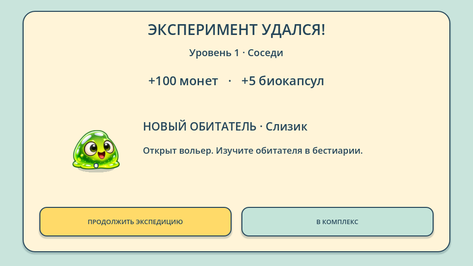
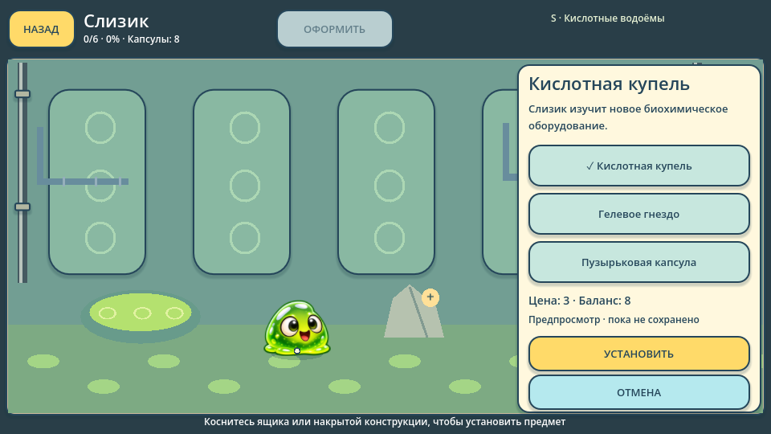
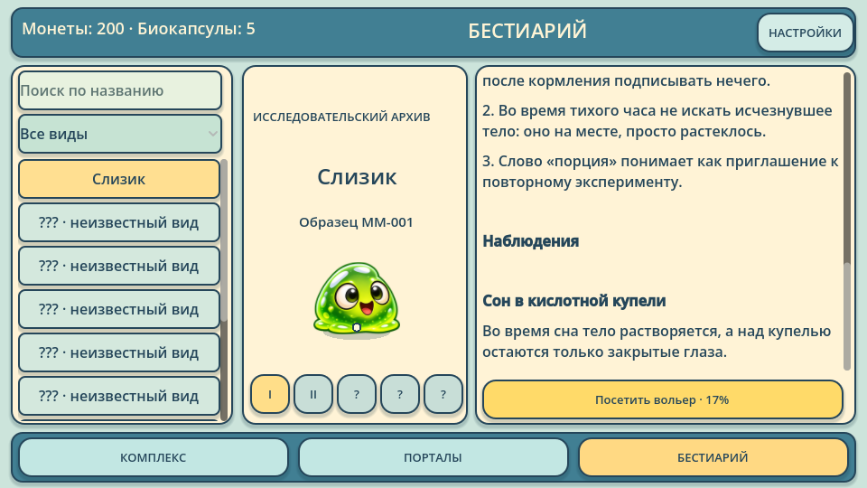
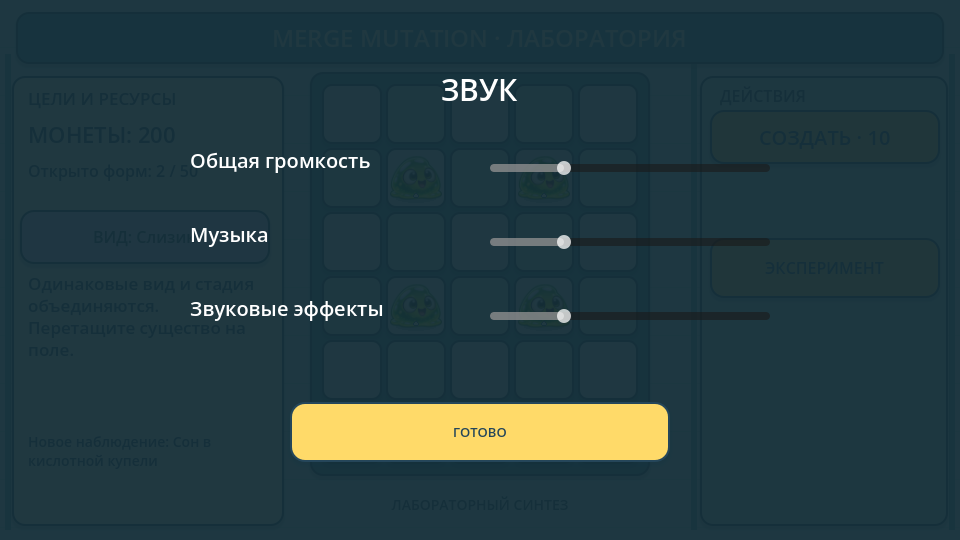

# PR21 — игровой цикл

Основа: merged PR20 (`03e766f`, включая уборку `c48ef9c`). Ветка: `feature/core-gameplay-loop`.

## Поведение

Экспедиция → настоящая головоломка кампании → сохранённая награда и вид → комплекс → установка предмета → завершённое действие обитателя → запись в существующем бестиарии → следующая экспедиция.

Новый профиль начинает с 3 биокапсул. Виды не выдаются через песочницу: реальные конфигурации кампании впервые открывают Слизика на уровне 1, Глазастика на 6 и Рогача на 10. Существующая коллекция форм используется без параллельного реестра. Старые открытия сохраняются. У Глазастика пока нет реализованного вольера: «На подготовке». Полноценные новые комнаты не добавлялись.

Панель результата показывает прежние монеты, новые капсулы, открытого обитателя, доступность вольера, продолжение и возвращение домой. Повторное прохождение явно помечено. Награда фиксируется до возможности уйти с панели; при ошибке записи доступны повтор сохранения и объяснение, а не частичная выдача.

Система ремонта сохраняет предметные стройплощадки, три варианта, предпросмотр, отмену и бесплатную смену установленного дизайна. Общий кошелёк виден в навигации, цена/баланс — на панели предмета. Автоматические декорации бесплатны. Новая валютная система описана в [economy-balance.md](economy-balance.md).

## Наблюдения и бестиарий

`ecosystem_state.action_completed` посылается после завершения действия. Один запрос или отменённый подход не открывает запись. Для тарана требуется действительно разбитый валун. Первые сон в купели, питание плазмой, биохимический анализ, тренировка Рогача, его сон и кормление проверены через настоящие модели. Есть дополнительные записи осмотра прибора и гордости после удара. Наблюдения одноразовые, ресурсов не дают.

В бестиарии используются читаемые заголовки и форматированный прокручиваемый текст. Технические `proud_ram`, enum и ключи в интерфейс не выводятся. Открытая запись содержит название и объяснение наблюдения; неподтверждённые записи не перечисляются как факты. Библия мира и предварительный канон не переписывались.

## Архитектура

- `core_game.gd` расширяет прежний main: валидация, миграция, атомарные операции и подключение нового представления.
- `core_progress.gd` — правила из `data/core_economy.json`; неотрицательный кошелёк, история наград, предметы, наблюдения.
- `profile_store.gd` — временный файл, flush, rename и проверка исходного SHA-256 перед записью.
- `permanent_habitat.gd` — адаптер прежнего ремонта к единому профилю, без записи отдельного кошелька.
- `core_lab/complex/habitat/bestiary/result.gd` — небольшие расширения прежних экранов.
- `music_manager.gd` и `data/music.json` — [адаптивная музыка](audio-design.md).

Механика слияний, размещения, цен создания, монет, звёзд, тактических правил и Undo не изменена. Старый режим доступен тестам только при явном legacy-флаге и профиле внутри `.godot`. На Android legacy и developer-профиль запрещены независимо от debug-флага движка. Обычная debug APK не содержит видимых кнопок бесплатной выдачи или открытия видов. Старые изолированные тестовые инструменты сохранены.

## Сохранения

Основной профиль остаётся schema_version 2. Добавляется один `core_progress.version=1` с `bio_capsules`, `claimed_levels`, `habitats`, `observations`. Баланс, получение награды и установка предмета фиксируются в одном основном файле. Старый файл ремонта больше не является источником кошелька.

При первом переносе: проверить исходные данные; создать байтовую `.pre-core-loop-<sha12>.bak`; начислить 3 плюс положенные капсулы за завершённые уровни; перенести известные установленные дизайны v1/v2 бесплатно. Демо-очки никогда не конвертируются. Исходный sidecar ремонта сохраняется и также резервируется. Монеты, формы, настройки, кампания и неизвестные поля основного профиля сохраняются. Повторная миграция не начисляет ничего.

Отрицательный/неполный ledger, неизвестный дизайн, неподдерживаемая версия и повреждённый sidecar блокируют запись: исходник не заменяется новой игрой. Расхождение SHA при стороннем изменении файла блокирует операцию и предлагает перечитать профиль. Нужен перезапуск после внешнего изменения. Автоматические проверки работают исключительно с временными профилями внутренней `.godot`.

## Проверки и материалы

Godot 4.7.2 Steam, Windows, Compatibility renderer / RTX 5070. Все прежние 7407 headless-проверок и 2883 GPU-проверки сохранены. Новые: 194 модельных, 359 UI headless / 371 UI GPU, 55 адаптивного аудио. Холодная компиляция: 137 GDScript без ошибок/предупреждений. Отдельно проверены импорт, запуск, правила workspace и APK. Подробности команд в [плейтесте](core-gameplay-loop-playtest.md).

[Короткий цикл, 10,8 сек., Windows Movie Maker Godot](core-loop-media/core-loop.mp4). Это ускоренный автоматический проход интерфейса, не запись 15-минутного пользовательского плейтеста. Перемотка времени модели используется для проверки завершения наблюдения.

## Ограничения

Физический Android и эмулятор не были доступны. Windows synthetic touch не заменяет телефон. Нужны ручные оценки читаемости, безопасных зон, системного Back, восстановления, громкости, музыкальных стыков и атмосферы. Текущие 10 уровней остаются единственной основной кампанией; новые вольеры и рейтинговая система не добавлены. PR22 не начат, автоматическое объединение PR21 запрещено.