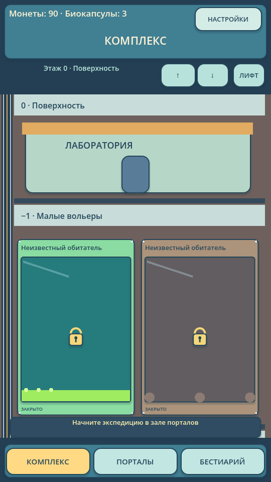
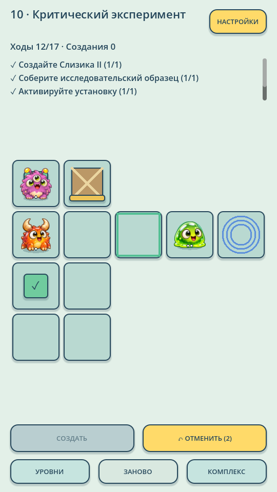
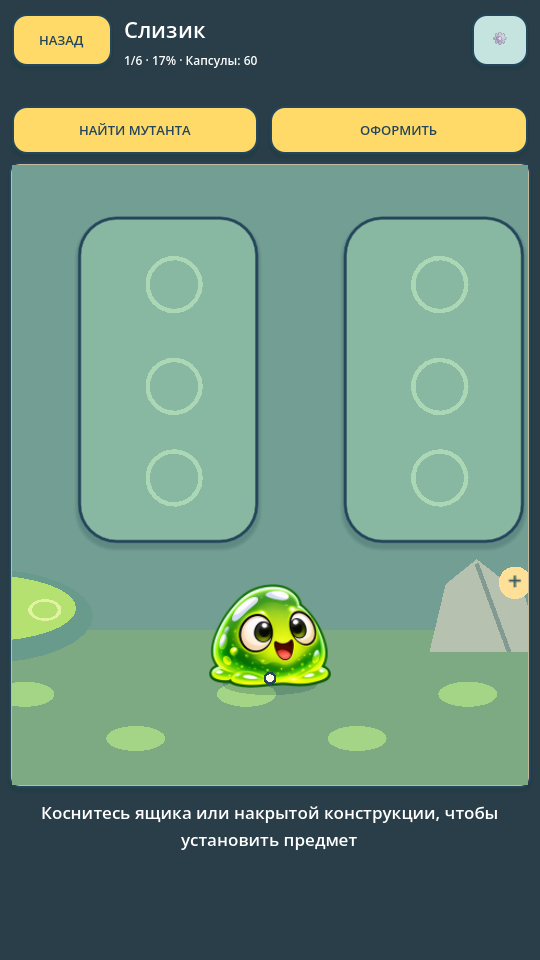
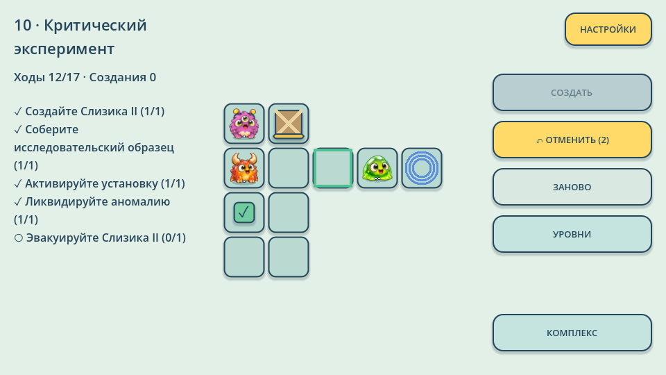

# Обновление PR22.1

Актуальное управление, APK23 и повторный плейтест описаны в [mobile-control-fix.md](mobile-control-fix.md). Ниже сохранён отчёт исходного PR22; его числа проверок/APK относятся к версии22.

# PR22 — Gameplay 2.0: Tactical Evolution

Основа — объединённый PR21, main `dbc98b5`. Ветка `feature/gameplay-evolution`. Godot 4.7.2.stable.steam.ed1daf0bf.

## Что изменилось

В портальном зале появилась отдельная «Тактическая эволюция»: десять экспериментальных головоломок. Слияние используется, когда требуется новая стадия; большинство задач решается перемещением, способностями и взаимодействием с окружением. В режиме доступны временные Слизик, Рогач, Крылатик и Глазастик. Их использование не открывает виды в постоянной коллекции.

Старая кампания, JSON уровней, монеты, биокапсулы, ремонт, коллекция, музыка и правила сохранений PR21 сохранены. Новый режим не вызывает профильные начисления, не платит награды, не открывает комнаты. Отметки пройденных экспериментов живут до закрытия режима. Перезапуск приложения начинает новую попытку; смена ориентации и обычное сворачивание сохраняют текущую сессию в памяти.

Подробности: [механики](puzzle-mechanics.md), [уровни, минимумы и решения](experimental-campaign.md), [подсказки](contextual-tutorial.md), [ручной плейтест](gameplay-evolution-playtest.md).

## Ориентация и управление

По умолчанию сохранена горизонтальная ориентация. Настройки → «Вертикально ⇄ Горизонтально» включает экспериментальную компоновку 540×960; горизонтальная база — 960×540. Выбор запоминается в прежнем файле настроек звука. Между локациями ориентация не меняется. На Android вызывается screen_set_orientation, а не поворот изображения.

Адаптированы комплекс, порталы, карты/предпросмотр, основная и новая кампании, старые тактические испытания, вольеры, бестиарий, песочница, настройки и результаты. Вертикальное поле занимает 500 из 540 логических пикселей. Масштаб безопасной области одинаков по X/Y; проверяются 16:9, 18:9, 19.5:9, 20:9, 16:10 и вертикальные аналоги.

Вольер использует равномерный масштаб мира, ограниченную горизонтальную камеру, свайп и кнопку поиска обитателя. Узкое окно показывает часть комнаты; предметы доступны прокруткой и могут быть центрированы. Это не растяжение всей панорамы по ширине. Предпросмотр и установка сохраняют прежние цены и бесплатную смену оформления.

С обновления PR22.1 в головоломках работает только короткое нажатие на мутанта → нажатие на цель. Удержание и свайпы не выполняют действия. Подсветка показывает допустимые команды и цену. Длинная команда по свободной прямой платит за каждую обычную клетку; промежуточное препятствие/занятый тайл/завершение уровня отменяет всю недопустимую команду. У основной кампании сохраняется семантика каждого прежнего примитивного шага. Песочница сохраняет прежние правила и цену создания 10 монет.

Отменённые touch-события не перемещают существ и не открывают портал. Второй палец игнорируется. Для списков и текста добавлен scoped touch/wheel scroll без эмуляции мыши; обработчик не перехватывает жесты у окна настроек.

## Модальные окна и результаты

Настройки имеют непрозрачную поверхность на весь экран, непрозрачную карточку, затемнённое окружение и Stop-фильтр ввода. Базовое поле не видно и не реагирует. Строительный предпросмотр имеет отдельный блокирующий слой, расположенный перед карточкой также в порядке GUI-ввода. Скрытая симуляция вольера приостановлена; возврат сохраняет комнату и возобновляет её.

Повтор прохождения — небольшая вторичная кнопка 170×44. На последнем основном уровне приоритет — большая кнопка возвращения в комплекс. Существующие звёзды не пересчитывались. Back сначала закрывает настройки/предпросмотр, затем возвращает в предыдущий раздел; в новом режиме — из попытки к списку, затем в комплекс.

## Архитектура и совместимость

`evolution_game/lab` расширяют PR21. Отдельные адаптеры представления используют прежние модели комплекса, порталов, бестиария и ремонта. Новая сессия расширяет CampaignSession, использует прежние формы и переиспользует MutationHistory и Dijkstra solver. Правила и данные находятся в `evolution_session.gd` и `evolution/levels/`.

Старые тесты представления выполняются в прежних режимах с явными флагами и изолированными профилями. `--pr21-regression` выбирает предыдущий UI только на desktop и только с тестовым профилем внутри `.godot`. На Android этот путь недоступен. Это не изменение старых проверок или отмена нормальной экономики.

Основной профиль остаётся schema_version 2, core_progress.version 1. Портретный режим и tutorial version 1 хранятся в существующем ConfigFile рядом с аудио; чужие поля сохраняются. Обработчики pause/resume отменяют незавершённый жест, сохраняют основной профиль, приостанавливают аудио и скрытую симуляцию. Windows-синтетика не удостоверяет работу конкретного Android lifecycle.

Цели подсветки кешируются по состоянию/выбору: redraw не запускает повторную симуляцию всех маршрутов. Solver не запускается при обычном прохождении; используется офлайн в тестах. Максимальный доказанный поиск — 9559 состояний для уровня 10 (~3,4 секунды на этой Windows-машине). Телефонные CPU/RAM/нагрев пока не измерены.

## Материалы

[Видео новых механик, Windows, горизонтальная запись](evolution-media/tactical-evolution.mp4). Оба варианта интерфейса показаны на PNG; видео использует настоящие действия UI и тот же solver-план, а не имитацию результата.

## Проверки и ограничения

Результаты: 9167 headless / 4210 GPU проверок, 0 failures; 164 GDScript без ошибок/предупреждений; 49 workspace-контрактов; 30 проверок APK, включая прежний сертификат/пакет и все 10 новых JSON.. Прежняя база — 8015 headless / 3309 GPU проверок — сохранена. Все 10 новых уровней имеют оптимальные решения, проверенные через модель и через UI в обеих ориентациях. Проверены Undo механизмов, сохранность кошелька/коллекции, v2, смена ориентации, перезапуск в portrait, жесты, отменённые касания, быстрые свайпы, непрозрачность, размеры кнопок, пять соотношений сторон и touch scrolling.

APK: `builds/android/merge-mutation-pr22.apk`, тот же package ID `org.mergemutation.prototype.debug`, versionCode 22. Подпись сравнивается с APK PR21. APK/logs/cache не входят в Git. Подключённых adb-устройств и AVD не найдено: установка обновлением, физические touch/Back, вырезы, реальный Android suspend/resume и производительность требуют ручной проверки. PR не объединять автоматически; PR23 не начинать до плейтеста.
Проверенный APK: 37156627 байт; SHA-256: 59D9C7E03EAC28C787C9AF72525E6F2397E5A184C1BF042DC047CDC50C07DE71. Debug-подпись v2/v3 совпадает с PR21; 16 KiB alignment проверен. Установка обновлением на телефоне остаётся ручной приёмкой.
