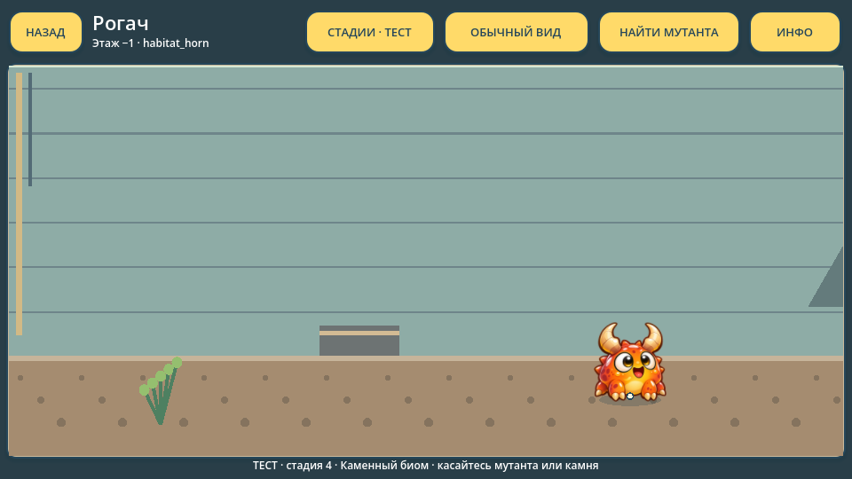
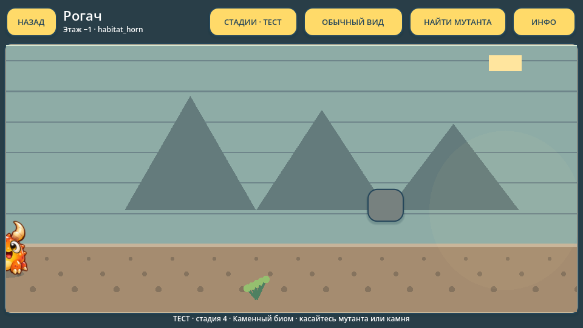
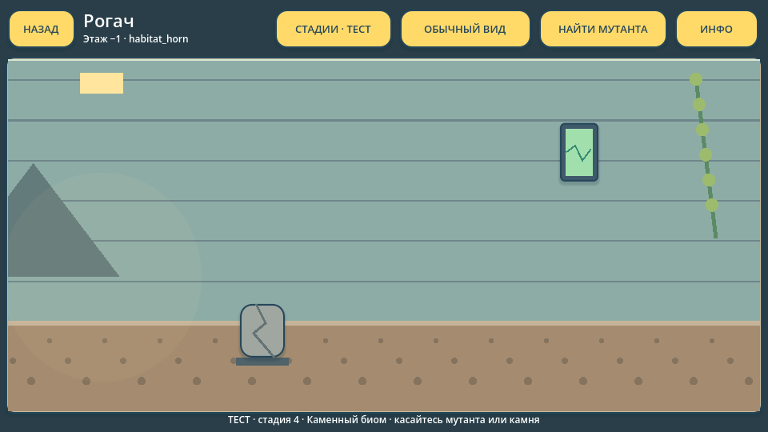

# PR №17 · экспериментальный горизонтальный режим

Основа — актуальный main `0d85274a93f271d6996ed4e880b91deca0d261cb`, merge PR №16. Перед созданием `experiment/landscape-mode` подтверждены объединение PR №16, чистое рабочее дерево и обновление main. Вертикальная версия main не изменена. Автоматическое объединение не выполняется.

## Компоновка

Базовая область 960×540, Android orientation=landscape. Godot использует `canvas_items` и `expand`: дополнительная площадь экрана доступна корневому Control, а `landscape_layout.fit` равномерно вписывает интерфейс в доступную безопасную область. На широком экране добавляются поля по бокам; на 16:10 — сверху и снизу. Интерфейс не растягивается по разным осям, спрайты сохраняют пропорции. Android safe area переводится из физических координат в координаты корневого Control. Нажатия вне логической области не создают существ.

Проверены настольные окна 960×540, 1080×540, 1170×540, 1200×540 и 960×600; отдельно проверено математическое вписывание с отступами. Это проверка геометрии и синтетического touch на Windows, а не проверка вырезов на Android.

| Экран | Горизонтальное представление |
|---|---|
| Лаборатория / песочница | Поле 5×6 с шагом 64, слева ресурсы, вид, сообщения; справа создание и навигация |
| Кампания | То же поле, цели и ходы слева, создание, телепорт, повтор и выход справа |
| Тактические испытания | Поле по центру, цели слева, создание, отмена, перезапуск и выход справа |
| Список испытаний | Описание слева, прокручиваемый список справа, кликабельная вся ширина строки |
| Порталы | Стенд/двери слева, данные выбранного мира справа; сплошной непрозрачный фон |
| Карта | Слева мир и возвраты, справа широкая прокручиваемая карта; прежние ID, туман и ограничения запуска |
| Предпросмотр | Название слева, реальные цели/бустеры/результат справа в прокручиваемой области |
| Сюжет | Персонаж слева, реплика и кнопки справа |
| Коллекция, виды, настройки, результаты | Широкая модальная панель с прокруткой; кнопка закрытия закреплена снизу |
| Подтверждение сброса | Нативное окно 460×200, отмена не меняет прогресс |
| Комплекс | Прокрутка 804×450, фиксированная правая навигация; увеличенные комнаты и высоты |
| Детальный вольер | Среда 940×440, компактная верхняя панель и отдельное меню тестовых стадий |

Отдельного стартового экрана в проекте нет.

## Архитектура и сохранность правил

Новые `landscape_*.gd` наследуют существующие представления. Фабрики в `lab_view.gd` и `underground_complex.gd` выбирают представление; модель кампании, tactical session/history/search, конфигурации уровней, экономика и save codec не скопированы и не изменены. `main.gd` направляет определение клетки в новое представление и отсекает нажатия в полях вокруг него.

Общие модели карты и комплекса получили необязательную ширину; значения по умолчанию сохраняют исходную геометрию вертикальных тестов. Геометрия комнат проецируется при открытии комплекса без изменения исходных JSON, ID этажей и вольеров. На −1 остаются два малых вольера, на −2 средний, на −3 гигантская камера, на −4 три помещения. Ограничения доступности и демонстрационные замки прежние.

Представление окружения принимает ширину мира и положение камеры. Единственный HabitatState и единственный HabitatActor используются совместно обзором и деталью. Только видимая среда обновляет модель; обзор при открытой детали и невидимые этажи приостановлены. Обзор широкой среды следует за обитателем. Возврат сохраняет прокрутку и подсветку.

Сохранения остаются v2: монеты, независимые виды и стадии, коллекция, кампания, песочница, дополнительные неизвестные поля. Демонстрационные стадии, режим панорамы, камера и оформление объектов не записываются. Старые подсказки путешествия по-прежнему могут записать свой флаг при первом посещении — это существующее поведение.

## Панорамный вольер

Кнопка «ПАНОРАМА» переключает временную геометрию 940 ↔ 2350 единиц: мир шириной 2,5 видимых области, высота 420. Изменяется конфигурация того же временного обитателя; выбранная демонстрационная стадия сохраняется, временное действие и позиция сбрасываются к старту нового режима. Выйти из комплекса и открыть его заново — начать демонстрацию заново.

Декорации распределены по западной, центральной и восточной зонам. Модель ходит в координатах мира; камень остаётся твёрдым препятствием. Рогач может пройти границы зон до тренировочного камня, а не проходить сквозь него. Масштаб актёра не зависит от полной ширины мира. Камера перемещает узел мира, не создавая копий существа.

Мышь и первый touch: перетаскивание по горизонтали, инерция и ограничение 0…1410. Накопленный путь ≥12 считается свайпом даже при возврате пальца в исходную точку. Отмена touch сбрасывает жест. «Найти мутанта» гасит инерцию и плавно центрирует камеру в допустимых пределах; пустая первая стадия отключает эту кнопку.

Скорость временной демонстрации составляет 58 единиц/с в обычной среде и 80 в панорамной. Драйвер движения, набор состояний, cooldown и цикл тарана берутся из существующего профиля, без отдельной копии машины поведения.

При коротком нажатии сначала проверяется тренировочный камень, затем мутант. Касание камня запрашивает прежний таран с прежними ограничениями, касание мутанта — прежнюю реакцию и cooldown. Больших постоянных кнопок реакции и тренировки нет. Спального места в исходной конфигурации нет: существующая скамья остаётся декорацией, отдельная новая механика сна предметом не добавлена. Автономный сон сохранён.

Стадии открываются кнопкой «СТАДИИ · ТЕСТ». Back/Escape сначала закрывает это меню, затем возвращает в комплекс. Информация о комнате приостанавливает среду.

## Направление будущего развития комнат

Следующая система должна развивать отдельные предметы, постепенно наполняя помещение, и предлагать три оформления каждого улучшения. Не следует подменять её только глобальным номером стадии.

- Стабильный ID вольера: существующий `habitat_horn`.
- Зоны: `west`, `central`, `east`; границы задаются геометрией, ID не зависят от размера экрана.
- Объекты: существующие `monitor`, `bench`, `training_rock`, `fern`, `grass`, `ridge`, `boulder`, `vine`, `lamp`. Перемещение декорации не меняет её ID.
- Для будущих вариантов закрепить независимые ID `design_a`, `design_b`, `design_c`, а не индексы кнопок/PNG. Ещё не существующие варианты не показываются как доступные улучшения.
- Взаимодействовать непосредственно с предметами. Поведение задавать профилем вида и отдельным драйвером движения; горизонтальный наземный драйвер Рогача не считать универсальным для летающих видов.

В этом PR нет наград, покупок, постоянных улучшений, выбора дизайна, новых видов и полей сохранения для них.

## Проверки и воспроизведение

Финальный прогон Godot 4.7.2, ошибок и предупреждений нет. Все тестовые профили находятся в исключённой `.godot/`; реальные пользовательские сохранения тестам не передаются.

| Набор | Headless | GPU / Windows |
|---|---:|---:|
| Прежние регрессии | 5160 | 988 |
| Новый landscape_ui_test | 454 | 498 |
| Новый landscape_navigation_test | 376 | 381 |
| **Всего** | **5990** | **1867** |

Холодная компиляция: **87 GDScript, 0 ошибок**. Первичный и повторный импорт прошли без ошибок/предупреждений; Godot создал необходимые UID двух новых тестов. Повторный импорт не меняет project.godot и настройки игровых PNG. Обычный headless-запуск основной сцены также прошёл. `git diff --check` чистый.

Все десять доказанных тактических минимумов подтверждены прежним solver-тестом, решения повторены через горизонтальный UI. Все десять уровней кампании пройдены native mouse/touch; проверены повтор без награды и телепорт. Проверены две отмены в прежнем наборе, целиком отменяемый длинный маршрут в новом, масштаб и края камеры, поиск после инерции, свайп туда-обратно без реакции, пауза под инфо и ограниченное число активных этажей в конфигурации 50 этажей.

В каталоге 37 итоговых GPU-кадров. Подробный список файлов изменения: [landscape-changed-files.txt](landscape-changed-files.txt).

```powershell
# Из MergeMutation. Укажите путь к установленному Godot 4.7.2.
$godot = 'C:/Program Files (x86)/Steam/steamapps/common/Godot Engine/godot.windows.opt.tools.64.exe'
./tools/check_landscape.ps1 -GodotPath $godot -IncludePortraitRegression
./tools/check_landscape.ps1 -GodotPath $godot -Gpu -IncludePortraitRegression
./tools/check_gdscript.ps1 -GodotPath $godot
```

Прежние UI-регрессии имеют жёсткие координаты 360×720. Они запускаются явно с внутренним аргументом `-- --portrait-regression`, выбирающим исходные представления и viewport для проверки совместимости. Их прохождение не выдаётся за тест горизонтальной компоновки. Два новых набора без этого флага проверяют обычный горизонтальный запуск, реальные native mouse/touch, все десять тактических решений, все десять уровней кампании, возвраты и сохранения, пять форматов экрана, телепорт, отмену, длинный маршрут, панораму и комплекс из 50 этажей.

GPU-прогоны используют OpenGL Compatibility / RTX 5070 на Windows. Android APK не собран: Java и шаблоны экспорта 4.7.2 присутствуют в установке Steam; Android SDK/adb по настроенному пути не обнаружены, export_presets.cfg отсутствует. На физическом Android и эмуляторе ничего не проверено. Нужны ручные проверки безопасной области, размера текста/целей касания, системного Back, сворачивания/возобновления и производительности устройства.

## Скриншоты и сравнение

Все новые изображения — реальные кадры Godot, не макеты. [Каталог](landscape/) содержит основные экраны, четыре стадии, три участка панорамы и пять соотношений сторон. Каталог исключён из Godot-импорта собственным `.gdignore`: это документация, игровые PNG не изменены.

| Экран | Вертикальная основа | Горизонтальный эксперимент |
|---|---|---|
| Лаборатория | [Поле](species-field.png) | [Лаборатория](landscape/landscape-laboratory.png) |
| Испытание | [Узкий проход](challenge-level-06.png) | [Узкий проход](landscape/landscape-tactical-06.png) |
| Комплекс −1 | [Обзор PR16](living-floor_01.png) | [Широкий обзор](landscape/landscape-floor_01.png) |
| Гигантская камера | [Обзор PR16](living-floor_03.png) | [Широкая камера](landscape/landscape-floor_03.png) |
| Вольер IV | [Деталь PR16](living-stage-4.png) | [Широкая среда](landscape/landscape-habitat-stage-4.png) |





Окончательное решение об ориентации отложено до сравнительного плейтеста. Текущая графика экспериментальная; широкие среды намеренно используют существующие декорации, полная художественная переработка не проводилась.

## Изменённые файлы

- Конфигурация и вход: `project.godot`, `scripts/main.gd`, `README.md`.
- Минимальные точки расширения существующих представлений: `scripts/lab_view.gd`, `mutation_experiment.gd`, `story_screen.gd`, `underground_complex.gd`.
- Геометрия моделей: `scripts/complex_registry.gd`, `world_map_model.gd`, `living_registry.gd`, `habitat_environment.gd`.
- Новое представление: `scripts/landscape_layout.gd`, `landscape_lab.gd`, `landscape_portal.gd`, `landscape_preview.gd`, `landscape_story.gd`, `landscape_experiment.gd`, `landscape_complex.gd`, `landscape_floor.gd`, `landscape_habitat.gd`, `landscape_living_config.gd`.
- Проверки: `tests/landscape_ui_test.gd`, `tests/landscape_navigation_test.gd`, `tools/check_landscape.ps1`.
- Документация: этот файл, `landscape-mode-playtest.md`, изображения `docs/landscape/landscape-*.png` и `docs/landscape/.gdignore`.
- Новые GDScript сопровождаются создаваемыми Godot файлами `.gd.uid`.

Исходные игровые PNG, JSON уровней/видов/кампании, правила, solver и формат сохранений не изменены.
