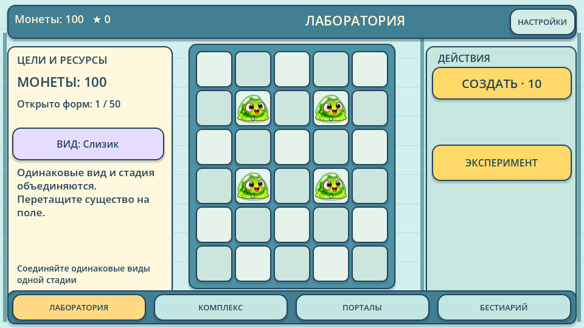
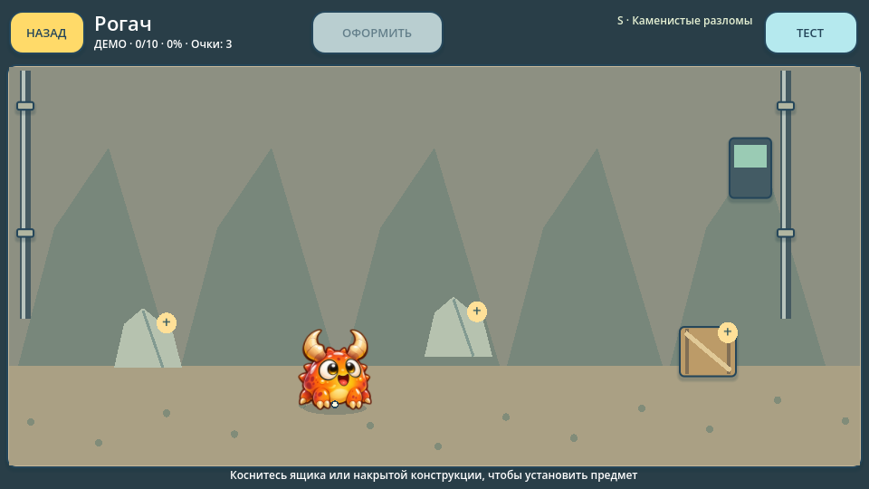
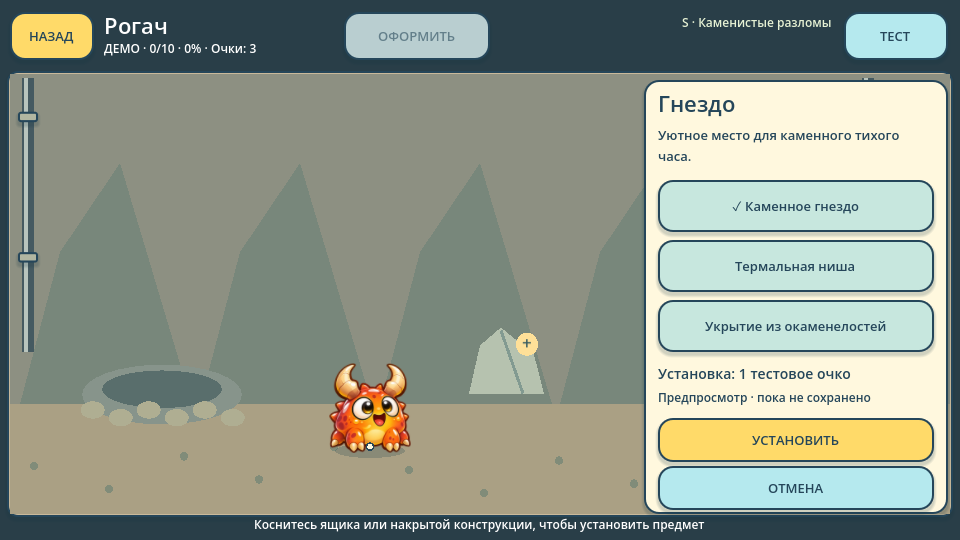
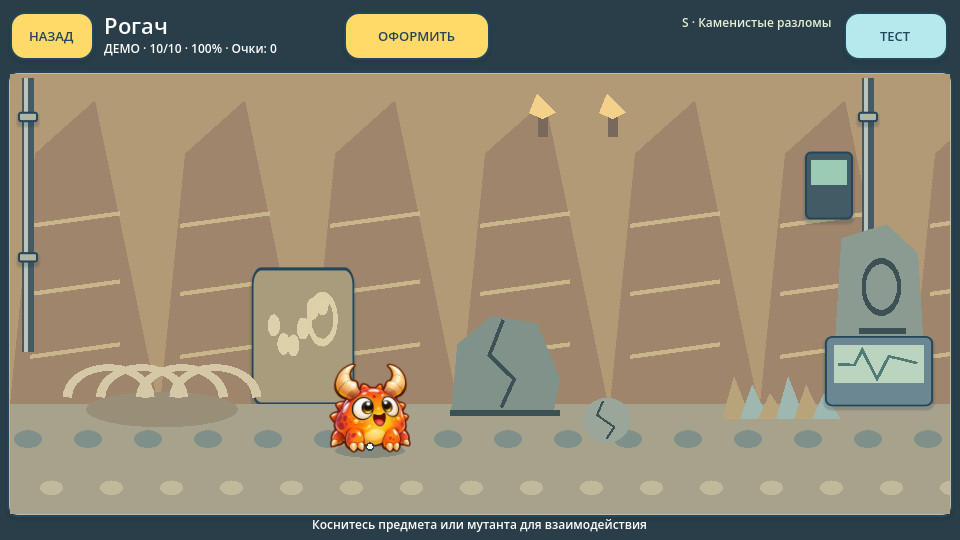
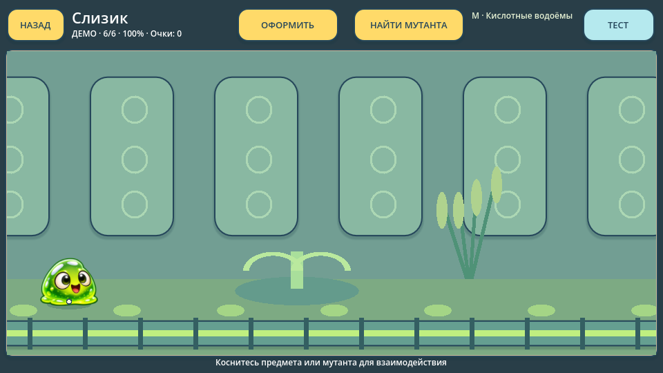
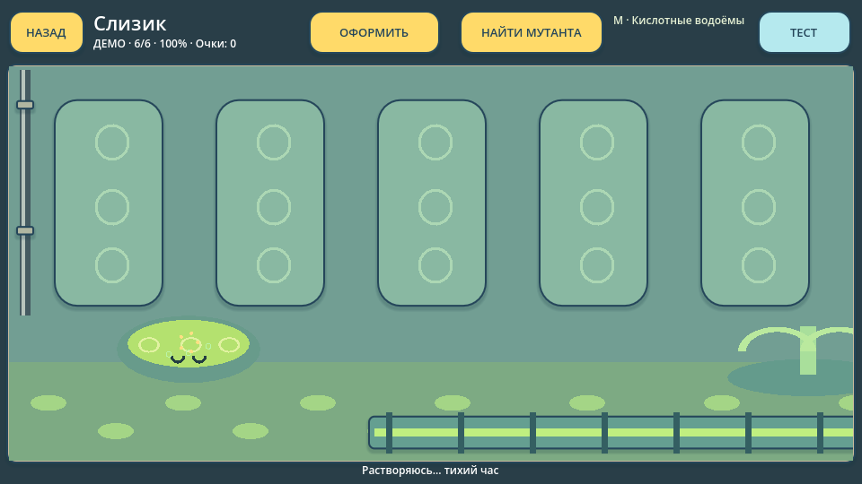

# PR19 — Living Ecosystems & Mobile UX

Основа: main `f55f827` с объединённым PR18. Ветка `feature/living-ecosystems`.
Godot 4.7.2, горизонтальный логический экран 960×540. PR не объединяется автоматически.

## Что изменено

- Колёсико больше не закрывает вольер. Причина: `mouse_force_pass_scroll_events`
  пропускал событие к скрытому комплексу, чей обработчик прокрутки выполнял переход
  между этажами и закрывал detail. Вольер поглощает прокрутку; комплекс дополнительно
  игнорирует навигационный ввод при открытом detail/modal. В M колесо перемещает камеру,
  над панелями не перемещает фон. До исправления отдельный тест давал 24 ошибки из 25.
- `app_chrome.gd` — общая панель ресурсов, настроек и четырёх действующих разделов:
  лаборатория, комплекс, порталы, бестиарий (существующая коллекция). Головоломки,
  предпросмотр, сюжет и детальный вольер сохраняют специализированный интерфейс.
  Общая навигация использует уже существующее масштабирование и Android safe area
  внешнего landscape-контейнера. Физический вырез телефона не проверен.
- Ручная кнопка панорамы удалена из нового UI. Размер задаёт конфигурация: S=940,
  M=1880, L=2820, XL=4700 логических единиц. Рогач — S, Слизик — экспериментальный M.
  Свайп, инерция, пределы и различение касания сохранены. Поиск мутанта виден только
  в прокручиваемой комнате; положение камеры сохраняется между входами в текущем сеансе.
- Доступны максимум три стройплощадки/ящика/накрытых конструкции. Порядок задаётся
  `reveal_order`, зависимости и лимит проверяются каталогом. Первая установка открывается
  касанием объекта без режима ремонта; предпросмотр и отмена ничего не списывают.
  Установка стоит одно демо-очко; смена установленного оформления бесплатна.
  «Оформить» меняет только уже установленные объекты. Очки остаются в отдельном меню «Тест».

## Данные и поведение

`data/ecosystems.json` содержит ссылки на существующие `species_id`/`habitat_id`,
происхождение, характер, размеры, отдельные профили движения, драйверы, доступные действия,
предпочтения, привычки, веса, интервалы повторения и редкие события. Это метаданные среды,
а не второй реестр видов. Коллекция и условия открытия видов не меняются.

Общая инфраструктура переиспользует существующий шестисостоянийный FSM и модульный ремонт.
`ecosystem_factory` создаёт отдельную модель, геометрию и состояние ремонта на комнату;
обзор и detail используют эту же модель. `ecosystem_autonomy` выбирает доступные действия
с учётом расстояния, весов и времени предыдущего выполнения. Команда игрока прерывает
автономную цель; блокировки команд, предел времени подхода и cooldown редких событий
предотвращают бесконечные действия. Есть детерминированный сброс RNG для тестов.
Не добавлены шкалы потребностей, штрафы за отсутствие ухода или новые таймеры Node.

### Рогач

10 слотов × 3 оформления: скальный фон, грунт, гнездо, минеральная кормушка,
тренировочный объект, монумент, трофеи, свет, игрушка, исследовательское оборудование.
Все 30 вариантов различаются процедурными силуэтами/деталями. Старые slot_id сохранены.
`canyon_art.gd` рисует среду, `horn_ecosystem_behavior.gd` — видовые позы и реакции.

Самостоятельно гуляет, отдыхает тремя способами, ест минералы, изучает новый предмет,
таранит тренировочную цель, играет и исследует оборудование. Редкие события: чихание
от пыли, попытка сдвинуть монумент, гордость после успешного тарана. Для последних двух
проверяются близость к монументу и недавний успешный удар соответственно.

### Слизик

6 независимых слотов × 3 оформления: кислотное ложе, питание плазмой, резервуар,
токсичные растения, каналы, лаборатория. Отдельные `acid_art.gd`, `slime_ground_motion.gd`
и `slime_ecosystem_behavior.gd`; Рогачу не копируется его профиль.
Слизик ползёт с пульсацией, сжимается, поглощает плазму, меняет оттенок/объём,
принимает кислотную ванну и реагирует на касание. Сон длится шесть секунд:
растворение → закрытые глаза над купелью → сборка тела → обычное движение.
Редкий «плюх» разбрызгивает жидкое тело без игровых бонусов.

## Сохранения и совместимость

Основной профиль v2, кампания, монеты, коллекция, правила объединений и награды не изменены.
Сохраняется имя sidecar `<profile>.habitat-demo-v1.json`, но его внутренний version становится 2.
Каждая комната имеет свои `installed` и `points`; запись читает актуальный sidecar и
сохраняет остальные комнаты и неизвестные поля. Поведение/камера — состояние сеанса,
оформление и демо-очки — постоянные данные.

`data/ecosystems/pr18-design-map.json` явно отображает все 30 старых дизайнов Рогача
в тематические новые. Тренировочные design_id сохранены; остальные сопоставлены по слоту
и варианту. Перед миграцией создаётся точная копия
`<sidecar>.pre-ecosystems-<12 символов SHA256>.bak`. Очки и дополнительные поля сохраняются.
Запись проходит через временный файл и замену после успешного завершения.

При неизвестном ID перенос не перезаписывает исходник: доступные известные предметы
показываются, комната становится read-only с объяснением, баланс сохраняется. Для v2
неизвестные оформления также блокируют запись. Для нестандартных данных следует сохранить
sidecar и backup, вручную уточнить mapping и повторить перенос. Альтернатива — явный
подтверждаемый сброс только демонстрационной комнаты через меню «Тест»; он создаёт backup.
Это не сброс основной игры. Неизвестные данные других комнат не удаляются.

## Совместимость и производительность

Старые классы и каталоги PR18 оставлены для прежних регрессий. Флаги
`--portrait-regression`, `--habitat-stage-regression`, `--ecosystem-legacy`
включают прежнюю презентацию только в тестовых запусках. Обычный запуск использует новый UI.
Структура этажей и виртуализация сохранены: на fixture из 50 этажей активно не более четырёх.
Невидимые комнаты приостановлены; детали освобождаются без создания второго резидента.
Процедурная графика временная; оформление порталов целиком не перерабатывалось.

## Проверки и материалы

Подробности и команды: [living-ecosystems-playtest.md](living-ecosystems-playtest.md).
Изоляция каталогов: [workspace-isolation.md](workspace-isolation.md).
Полный перечень файлов: [ecosystems-changed-files.txt](ecosystems-changed-files.txt).

Записи реального Godot Movie Maker, 960×540, 60 FPS:
[Рогач, 14,5 с](ecosystems/horn-behavior.ogv), [Слизик, 19 с](ecosystems/slime-behavior.ogv).
Это постановочные демонстрации на отдельных тестовых профилях: сценарий задаёт команды,
позиции между эпизодами и доступность редких событий; не запись случайного плейтеста.
Показаны настоящий таран, чихание, монумент, гордость, ползание, растворение/сборка,
питание и жидкий всплеск. OGV декодированы встроенным VideoStreamPlayer; проверены
размер и изменение кадров. Браузер GitHub может потребовать скачивания ролика.

## Ограничения

Android-устройство и adb/SDK в среде не обнаружены; APK, физический touch,
производительность телефона, вырезы и системный Back на устройстве не проверены.
Windows mouse и синтетический touch, отмена жестов, маршрут Back и пять пропорций проверены.
Нужен ручной плейтест читаемости и характера поведения. Реальные награды за развитие
вольеров и полноценный бестиарий остаются вне PR.
