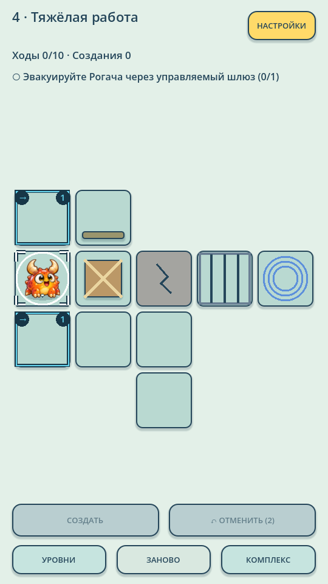
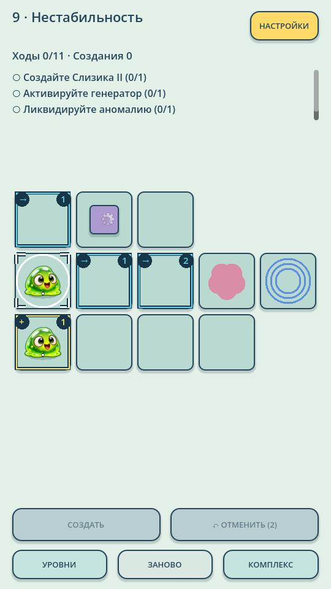
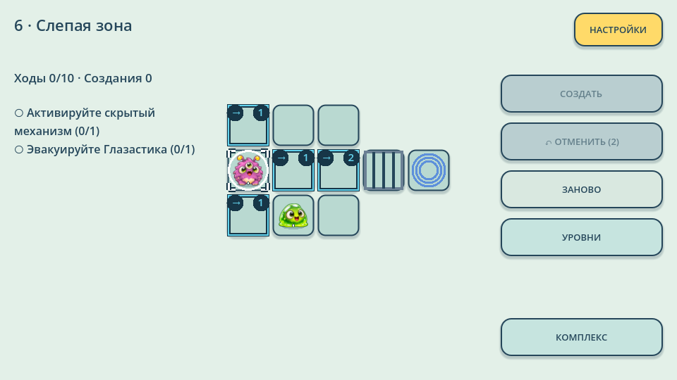

# PR22.1 — Mobile Control Fix

Продолжение PR22, ветка `feature/gameplay-evolution`, основа `96e8d2d`. Новый PR не создаётся, объединение не выполняется. PR23 не начат.

## Причина зависания

В исходном `evolution_screen.gd::_gui_input` ветка motion присваивала `actors[selected].position=point`. На отпускании вызывался `act(index)`. При диагонали/недопустимой цели `history.execute` возвращал `ok=false`, а `act` после уведомления завершался без `refresh` или возврата спрайта. Клетки модели не менялись, но позиция CanvasItem оставалась от жеста. Для отпускания на выбранной клетке был отдельный возврат, для отклонённой другой клетки его не было. Поэтому проблема зависела от конкретного завершения жеста, а не от сохранений или физики.

Дополнительный риск: остановка Tween при повороте/сворачивании без восстановления представления может оставить промежуточную позицию. Теперь завершение и прерывание визуализации восстанавливают координаты по текущей модели. Уже принятую команду не откатывают; для отката есть прежний Undo.

## Исправление

- В основной кампании, старых тактических испытаниях и Tactical Evolution отсутствует перемещение за пальцем/мышью.
- Общий `puzzle_tap.gd`: только короткое нажатие и отпускание в той же клетке. Порог движения 12 дизайн-единиц, максимальная длительность 450мс. Суммарный путь подавляет свайп туда-обратно; отмена и второй палец отменяют незавершённый жест.
- Первый tap выбирает, второй на допустимой цели выполняет действие. Повторный tap по источнику снимает выбор. Недопустимая пустая/заблокированная клетка сохраняет выбор и не отправляет команду. Другое существо переключает выбор, если допустимое слияние/взаимодействие не имеет приоритета.
- Дальние прямые маршруты, цена примитивных шагов, способности, механизмы и два бесплатных Undo сохранены.
- `busy` блокирует следующую команду на время анимации; в основной кампании окно блокировки 400мс покрывает движение/появление/слияние. При повороте, настройках и уходе в фон жест отменяется, Tween останавливается и визуальные координаты сверяются с моделью; история не очищается.
- Выбор обозначен контрастными угловыми скобками. Действия имеют отдельный значок и отдельную цену: → движение, + слияние, ! способность, # механизм, ◎ портал. Цвет — дополнительный признак.
- Подсказка `tap_controls` не требует drag и не сбрасывает прежние настройки/освоенные подсказки. Она доступна и игрокам с уже освоенной `movement`.
- Песочница сохраняет drag и прежнюю экономику; отдельно проверяется возврат реально смещённого спрайта при несовместимом слиянии и отмене touch. Свайпы комплекса, вольеров, порталов и бестиария сохранены.

## Проверки

Godot 4.7.2.stable.steam.ed1daf0bf. Прежние применимые наборы сохранены; в двух новых UI-наборах PR22 drag-решения заменены решениями через два нажатия. Новый `mobile_control_test.gd` проверяет отсутствие действий при удержании и свайпе, а не отключает старые проверки механик.

| Проверка | Результат |
|---|---:|
| Headless, 37 наборов с окончательным mobile_control | 19 669 успешно |
| Windows GPU, 17 наборов с окончательным mobile_control | 14 712 успешно |
| Новый mobile_control, каждый из двух режимов рендера | 10 503 успешно |
| Холодная компиляция GDScript | 168 скриптов, 0 ошибок |
| Workspace | 49 успешно |
| Финальная APK | 32 успешно |
| Импорт / запуск 180 кадров | Без ошибок и предупреждений |

Итоги учитывают последний mobile_control вместо предыдущего, без двойного суммирования повторных прогонов. Полные исходные прогоны: 19 661/14 704, затем добавлены восемь проверок реального смещения и отмены drag в песочнице, оба последних прогона успешны. GPU — Windows OpenGL на RTX5070; ввод mouse/touch синтетический. Все профили находятся в `.godot/`, пользовательские сохранения не читались и не изменялись.

Проверяемые случаи: недопустимые диагонали; быстрые повторные касания; удержание источника/цели; свайпы, включая возврат в исходную точку; второй палец и canceled; снятие/смена выбора; слияния, способности, механизмы, эвакуация; Undo после прерывания; поворот во время движения и позднее отпускание; сворачивание во время другого движения; соответствие всех 30 клеток и координат спрайтов. Все 10 классических, 10 старых тактических и 10 Evolution уровней исполняются через UI в обеих ориентациях. Старые модельные проверки по-прежнему доказывают решаемость и стоимость. Сохранены проверки миграции, повторных наград, экономики, коллекции, настроек, музыки и навигации.

Логи: `logs/tests/2026-11-19_10-01-28-592Z-pr22-fix-full-headless-headless-dfcdb2`, `logs/tests/2026-11-19_10-04-25-105Z-pr22-fix-full-gpu-gpu-60bd42`. Финальные дополнительные тесты: `logs/tests/2026-11-19_10-12-06-621Z-pr22-fix-final-mobile-script-597546`, `logs/tests/2026-11-19_10-12-21-521Z-pr22-fix-final-mobile-gpu-script-a67bb7`.

## Android

`builds/android/merge-mutation-pr22-fix.apk`, 37 165 133 байта (37.2МБ).

- versionCode23, versionName `2.0.0-pr22.1-test`.
- Package `org.mergemutation.prototype.debug`, прежний debug-сертификат; сравнение с APK22 успешно.
- SHA256 `1638A565D43D6B8A47E931822967D2DE5724CE954655DFF41B456C1267D0F72F`.
- 32 проверки APK: подпись, сертификат, версия, arm64, 16KiB alignment, все 10 JSON, новый обработчик и значки, прежние 9 OGG; тесты/инструменты/документация/ключи не экспортируются.
- APK, промежуточная сборка, кеши, профили и логи игнорируются Git. Ресурсы игры, конфигурации кампаний, цены/награды и музыкальные композиции не изменены.

Установка: `adb install -r "builds/android/merge-mutation-pr22-fix.apk"`. Не удалять приложение перед обновлением.

Физический плейтест исходного PR22 на Samsung Galaxy S26 Plus предоставлен пользователем: 10/10 пройдено, головоломки/разнообразие/подсказки4/5, производительность5/5, drag/tap2/5, portrait1/5, landscape2/5. Это не результат проверки новой APK23. Windows GPU и синтетические события не заменяют повторный Android-плейтест. Устройство/эмулятор для него в среде отсутствуют.

## Следующий этап

[Технический аудит portrait-first](portrait-first-audit.md): жёсткий холст и абсолютные координаты, конкурирующие зоны целей/сообщений, ограниченный обзор вольера и сжатие комнат. Предложения даны отдельно от реализации; художественные ресурсы и вертикальная компоновка сейчас сохранены. [Повторный плейтест](gameplay-evolution-playtest.md) должен предшествовать началу PR23.

## Скриншоты

В `docs/evolution-media/` находятся ещё пять снимков; воспроизведение: `run_godot.ps1 -Mode script -Script res://tools/capture_mobile_control.gd -Gpu` с установленным GodotPath. Это реальные Windows GPU-снимки, не Android-скриншоты.
